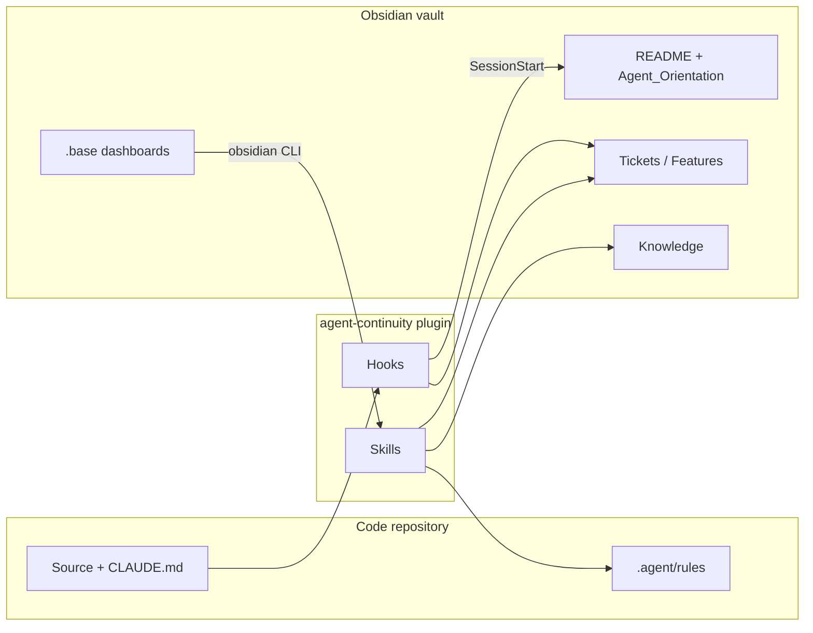
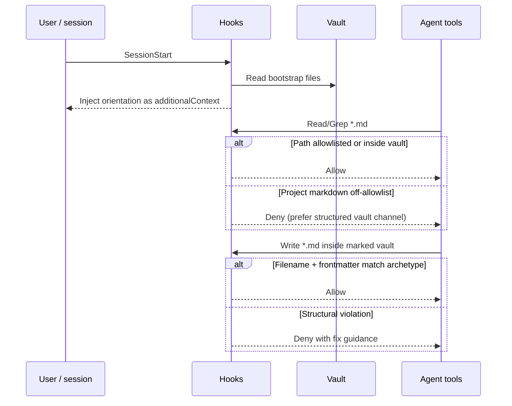
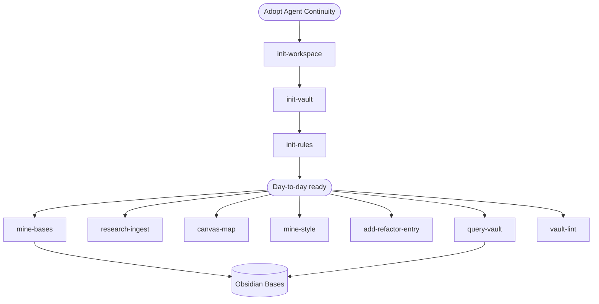
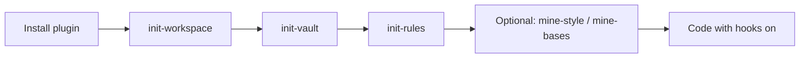
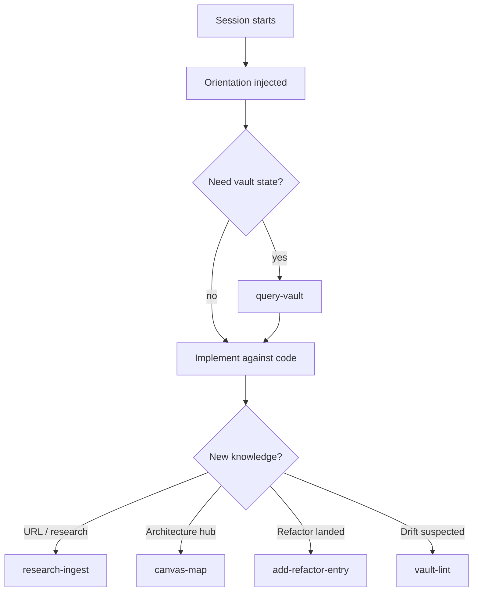

# Agent Continuity

[](https://github.com/Monolith-INC/agent-continuity/releases)
[](https://github.com/Monolith-INC/agent-continuity/tags)
[](https://code.claude.com/docs/en/plugins)
[](https://obsidian.md/)
[](./.plugin/plugin.json)

**Durable knowledge for coding agents.** Pair your repository with an Obsidian vault so agents keep orientation, tickets, style, and architecture context across sessions—instead of rediscovering the project every time.

### Claude Code

Install (curl):

```bash
curl -fsSL https://raw.githubusercontent.com/Monolith-INC/agent-continuity/main/adapters/claude/install.sh \
  | bash -s -- --repo Monolith-INC/agent-continuity --ref main
```

Marketplace (in Claude Code):

```text
/plugin marketplace add Monolith-INC/agent-continuity
/plugin install agent-continuity@agent-continuity
```

Uninstall:

```bash
curl -fsSL https://raw.githubusercontent.com/Monolith-INC/agent-continuity/main/adapters/claude/uninstall.sh \
  | bash -s -- --repo Monolith-INC/agent-continuity --ref main
```

### Cursor

Install (curl → `~/.cursor/plugins/local`):

```bash
curl -fsSL https://raw.githubusercontent.com/Monolith-INC/agent-continuity/main/adapters/cursor/install.sh \
  | bash -s -- --repo Monolith-INC/agent-continuity --ref main
```

Team marketplace: Dashboard → Plugins → Add Marketplace → Import from Repo → `Monolith-INC/agent-continuity` (uses root `.cursor-plugin/marketplace.json`).

Public marketplace: submit the repo at [cursor.com/marketplace/publish](https://cursor.com/marketplace/publish) after local verification.

Uninstall:

```bash
curl -fsSL https://raw.githubusercontent.com/Monolith-INC/agent-continuity/main/adapters/cursor/uninstall.sh \
  | bash -s -- --repo Monolith-INC/agent-continuity --ref main
```

### Codex

Install (curl):

```bash
curl -fsSL https://raw.githubusercontent.com/Monolith-INC/agent-continuity/main/adapters/codex/install.sh \
  | bash -s -- --repo Monolith-INC/agent-continuity --ref main
```

Marketplace (CLI; repo root ships `.agents/plugins/marketplace.json`):

```bash
codex plugin marketplace add Monolith-INC/agent-continuity --ref main
codex plugin add agent-continuity@agent-continuity
```

Uninstall:

```bash
curl -fsSL https://raw.githubusercontent.com/Monolith-INC/agent-continuity/main/adapters/codex/uninstall.sh \
  | bash -s -- --repo Monolith-INC/agent-continuity --ref main
```

Then `/reload-plugins` (or restart Claude Code / Reload Window in Cursor / new Codex thread).


---

## The problem

Coding agents are powerful **inside a session** and amnesic **across sessions**.

Without a durable store they:

- Re-read random markdown and invent project structure
- Lose open tickets, decisions, and style conventions
- Drift filename/frontmatter patterns until the vault is unqueryable
- Treat notes as disposable chat residue instead of a source of truth

Chat history is not a knowledge base. A pile of `.md` files without conventions is not one either.

## The solution

**Agent Continuity** makes an **Obsidian vault** the agent’s canonical knowledge base, then enforces the loop that keeps it useful:

| Layer | Role |
| --- | --- |
| **Vault** | Durable notes: tickets, knowledge, sessions, architecture |
| **Hooks** | Always-on: bootstrap orientation, allowlist reads, gate naming/frontmatter |
| **Skills** | On-demand: scaffold, mine history into notes, query Bases, ingest research, lint drift |
| **Archetypes** | Research-backed vault shapes (`software-project`, `research`, `personal-pkm`, `technical-docs`) |



---

## How it works

### Always-on hooks



1. **`SessionStart` — orientation injection**  
   Loads vault `README.md` + `Knowledge/Agent_Orientation.md` (configurable) into session context so every run starts oriented.  
   Then loads the session registry once into a small index (`<vault>/.agent-continuity/session-index.json`, git-ignored; only changed records are re-read) and appends a **session start menu** (default 3 recent records): resume the ongoing session, pick a recent one, or start fresh. Each record's `status` frontmatter (`ongoing` / `closed` / `archived`) drives it; archived records are hidden and only the newest record can be ongoing. The menu also handles a session past the 8-hour cap, a different checkout (the agent asks before resuming), and an unreadable record (the agent recovers from the last readable one without asking). Old-format records are upgraded automatically (apply, then report) when found or when the plugin version changed; see `reconcile-sessions`. The vault must sit inside the project: a setting pointing elsewhere is ignored, the default `AI_Codex*/` is used, and the agent asks for the right folder. Tune or turn off with `vault.sessionOptions` (`recent`, `enabled`, `folder`).

2. **`PreToolUse(Read|Grep)` — markdown allowlist**  
   Blocks casual reads of project `.md` outside a small allowlist and the vault. Pushes agents toward the vault / Bases instead of scraping every doc.

3. **`PreToolUse(Write)` — archetype naming enforcement**  
   Inside a marked vault, denies writes whose **filename shape**, **frontmatter keys**, or **enum values** (such as a session's `status`) violate the archetype spec. Fail-open outside marked vaults.

4. **`Stop` — session registry freshness**  
   Compares the code with the git snapshot from the previous turn and blocks the end of the turn once when a checkpoint is due: first change to a file, a new commit, a commit rolled back or amended, or a push, unless the ongoing record was already updated. Also asks once to roll over a session older than 8 hours, to open a record when none is ongoing, and to recover from an unreadable record. Never blocks twice in a row.

5. **`UserPromptSubmit` — decision reminder**  
   While a record is ongoing, adds one line reminding the agent to log a `## Decision` entry if the user's message settles one. Reads only the index. Turn 4 and 5 off with `vault.freshness.enabled: false`.

### Skills (interactive, confirm-before-write)

Most skills are walkthroughs: inspect → propose → confirm → write. They do **not** overwrite without per-file approval. `query-vault` is the exception: read-only and model-invocable.



---

## Skills catalog

Invoke as `/agent-continuity:<skill>`.

### Init — stand up the system

| Skill | Purpose | When to use | What to expect |
| --- | --- | --- | --- |
| **`init-workspace`** | Scaffold root + per-project `CLAUDE.md` from stack detection (`package.json`, `pubspec.yaml`, etc.) | New repo, or existing repo with no agent entrypoints | Proposed file tree; writes only after you approve each file |
| **`init-vault`** | Scaffold an Obsidian vault from an **archetype**; writes `.agent-continuity-vault.json` | First-time vault, or adopting the plugin on a project | Folder skeleton, orientation notes, optional `.base` dashboards (software-project); marker for hooks/lint |
| **`init-rules`** | Drop starter `.agent/rules/*.md` templates | Empty or missing rules set | Templates for implementation lock, architect protocol, git workflow, date/time handling |

**Archetypes** for `init-vault --type`:

| Type | Best for | Method basis |
| --- | --- | --- |
| `software-project` (default) | Agile/XP codebases | Tickets by status folder + Knowledge hybrid |
| `research` | Academic / research | Zettelkasten + PARA + MOCs |
| `personal-pkm` | Life / general PKM | PARA |
| `technical-docs` | Product / library docs | Diátaxis |

### Mining — turn history into canon

| Skill | Purpose | When to use | What to expect |
| --- | --- | --- | --- |
| **`mine-style`** | Mine an author’s git history into a canonical style-examples Knowledge note | You want agents to imitate real project style, not generic advice | Draft note with file/line anchors + Agent Rules block; confirm before write |
| **`add-refactor-entry`** | Append a before/after entry to the Style Refactor Catalog from a commit | After a meaningful refactor commit | Diff-derived catalog entry annotated with the principle applied |
| **`mine-bases`** | Backfill frontmatter + emit Obsidian Bases over Tickets/Features/Agent_Sessions | Vault exists but has no queryable dashboards | Property backfill (safe prepend), `.base` boards; status stays folder-encoded |

### Query & visualize — live vault channel

| Skill | Purpose | When to use | What to expect |
| --- | --- | --- | --- |
| **`query-vault`** | Read-only live queries via Obsidian CLI (`base:query`, `search`, `backlinks`) | Need open tickets, features by area, recent sessions, or search—without raw file dumps | Structured results when Obsidian is open; graceful degrade otherwise. **Model-invocable** |
| **`canvas-map`** | Build a JSON Canvas map for a hub note (links + backlinks) into `Architecture/` | Explaining or documenting a domain hub’s relationship graph | Validated `.canvas` with hub centered, outgoing/backlink sides, arrowed edges |

### Research & maintenance

| Skill | Purpose | When to use | What to expect |
| --- | --- | --- | --- |
| **`research-ingest`** | Fetch a URL with Defuddle → source-stamped `Knowledge/` reference note | Capturing an external spec/article into the vault with provenance | `type: reference` note + frontmatter (`source`/`domain`/`retrieved`) + index-friendly shape |
| **`reconcile-sessions`** | Upgrade old-format session records and refresh the session index | Start menu reports old-format records, or older notes were imported | Adds `status` / `date` / `type`, keeps one `ongoing`, adds forward links; originals backed up under `.agent-continuity/backups/` |
| **`vault-lint`** | Audit vault vs archetype; propose/fix drift | Legacy vault, rename mess, or pre-archetype notes | Structural report (filenames, frontmatter, strays, duplicate ticket ids) + semantic pass; `git mv` + wikilink repair on confirm |

---

## Typical workflows

### Cold start (new project)



1. Install + reload plugins  
2. `/agent-continuity:init-workspace`  
3. `/agent-continuity:init-vault` (pick archetype)  
4. `/agent-continuity:init-rules`  
5. As notes accumulate: `mine-bases`, `mine-style`

### Daily agent loop



### Retrofit an existing vault

1. Ensure a marker exists (or run `vault-lint --type …` / write `.agent-continuity-vault.json`)  
2. `/agent-continuity:mine-bases` to normalize frontmatter + Bases  
3. `/agent-continuity:vault-lint` to fix naming/frontmatter drift  
4. Point `vault.folder` in config if the folder is not `AI_Codex*`

---

## Installation

One command upgrades in place (replaces any prior managed install). From a clone: `./adapters/<host>/install.sh` or `./adapters/<host>/uninstall.sh`.

After an install or upgrade, the first session in each project upgrades any old-format session records automatically. To do it right away for one project, add `--project <folder>` to the install command.

Root marketplace indexes (for GitHub / team import):

| Host | Manifest |
| --- | --- |
| Claude Code | `.claude-plugin/marketplace.json` |
| Cursor | `.cursor-plugin/marketplace.json` |
| Codex | `.agents/plugins/marketplace.json` (also accepts `.claude-plugin/` / `.cursor-plugin/`) |

### Claude Code

Install (curl):

```bash
curl -fsSL https://raw.githubusercontent.com/Monolith-INC/agent-continuity/main/adapters/claude/install.sh \
  | bash -s -- --repo Monolith-INC/agent-continuity --ref main
```

Marketplace:

```text
/plugin marketplace add Monolith-INC/agent-continuity
/plugin install agent-continuity@agent-continuity
```

Or CLI: `claude plugin marketplace add Monolith-INC/agent-continuity` then `claude plugin install agent-continuity@agent-continuity`.

Uninstall:

```bash
curl -fsSL https://raw.githubusercontent.com/Monolith-INC/agent-continuity/main/adapters/claude/uninstall.sh \
  | bash -s -- --repo Monolith-INC/agent-continuity --ref main
```

### Cursor

Install (curl → `~/.cursor/plugins/local/agent-continuity`):

```bash
curl -fsSL https://raw.githubusercontent.com/Monolith-INC/agent-continuity/main/adapters/cursor/install.sh \
  | bash -s -- --repo Monolith-INC/agent-continuity --ref main
```

Team marketplace: **Dashboard → Plugins → Add Marketplace → Import from Repo** → `https://github.com/Monolith-INC/agent-continuity` (reads `.cursor-plugin/marketplace.json`).

Public Cursor Marketplace: after testing locally, submit at [cursor.com/marketplace/publish](https://cursor.com/marketplace/publish).

Uninstall:

```bash
curl -fsSL https://raw.githubusercontent.com/Monolith-INC/agent-continuity/main/adapters/cursor/uninstall.sh \
  | bash -s -- --repo Monolith-INC/agent-continuity --ref main
```

### Codex

Install (curl):

```bash
curl -fsSL https://raw.githubusercontent.com/Monolith-INC/agent-continuity/main/adapters/codex/install.sh \
  | bash -s -- --repo Monolith-INC/agent-continuity --ref main
```

Marketplace:

```bash
codex plugin marketplace add Monolith-INC/agent-continuity --ref main
codex plugin add agent-continuity@agent-continuity
```

Uninstall:

```bash
curl -fsSL https://raw.githubusercontent.com/Monolith-INC/agent-continuity/main/adapters/codex/uninstall.sh \
  | bash -s -- --repo Monolith-INC/agent-continuity --ref main
```

Open `/hooks` or restart the host so SessionStart / PreToolUse hooks attach to the current session.


### Dependencies

**Required for hooks:** `bash`, `jq`, `realpath`, `python3` (stdlib only).

**Optional for skills:**

| Skill | Needs |
| --- | --- |
| `query-vault`, `canvas-map` | [`obsidian` CLI](https://github.com/Yakitrak/obsidian-cli) + Obsidian running with the vault open |
| `research-ingest` | [`defuddle`](https://github.com/kepano/defuddle) (`npm install -g defuddle`) |

---

## Configuration

Zero-config default: autodetect vault folder via `AI_Codex*/`, bootstrap `README.md` + `Knowledge/Agent_Orientation.md`, sensible markdown allowlist.

Optional project file: `.claude/agent-continuity.config.json`

```json
{
  "vault": {
    "folder": "AI_Codex_MyProject",
    "bootstrap": [
      "README.md",
      "Knowledge/Agent_Orientation.md"
    ]
  },
  "markdownAllowlist": {
    "patterns": [
      "CLAUDE.md",
      "GEMINI.md",
      ".agent/*",
      "docs/*",
      "projects/*/CLAUDE.md",
      "projects/*/GEMINI.md",
      "projects/*/.agent/*",
      "projects/*/e2e_test/*"
    ]
  },
  "namingEnforcement": {
    "enabled": true
  }
}
```

See [`examples/agent-continuity.config.example.json`](./examples/agent-continuity.config.example.json).

**Legacy (still read):** `.claude/codex-workflow.config.json`, `codex.folder` / `codex.bootstrap`, marker `.codex-vault.json`.

---

## What the plugin package contains

Flat Open Plugins layout (repo root = plugin):

```text
agent-continuity/
├── .plugin/plugin.json           ← Open Plugins manifest
├── .claude-plugin/               ← Claude marketplace + plugin manifests
│   ├── marketplace.json          ← source: ./
├── .cursor-plugin/               ← Cursor marketplace + plugin manifests
│   ├── marketplace.json          ← source: ./
├── .agents/plugins/marketplace.json ← Codex-native marketplace index
│   └── plugin.json
├── hooks/                        ← SessionStart + PreToolUse
├── skills/                       ← ten interactive skills
├── archetypes/                   ← four vault specs + marker contract
├── scripts/vault-lint.py         ← deterministic structural scanner
├── references/                   ← frontmatter convention
├── examples/                     ← config example
├── adapters/                     ← Cursor / Claude / Codex build + curl install
├── docs/
└── README.md
```

Deep dives:

- [Former package README](./docs/plugin-package-readme.md) — hooks internals, layout, roadmap history  
- [Vault archetypes](./archetypes/README.md)  
- [Frontmatter convention](./references/frontmatter-convention.md)  
- [Obsidian leverage map](./docs/obsidian-leverage.md)  
- [Host matrix](./docs/HOST_MATRIX.md)

---

## Design principles

1. **Vault is canon** — orientation and durable decisions live in Obsidian, not only in chat.  
2. **Non-destructive by default** — skills propose; users confirm; prefer deprecate over delete.  
3. **Status by folder** — ticket status is the path (`Tickets/Active/…`), never a duplicated `status:` field.  
4. **Structure is enforceable; semantics are lintable** — hooks gate shape/keys; `vault-lint` handles judgment calls.  
5. **Fail-open outside the contract** — no marker / unknown archetype → hooks do not block ordinary work.  
6. **Structured read channel** — prefer Bases / `query-vault` over scraping every markdown file.

---

## Migration from `codex-workflow`

| Old | New |
| --- | --- |
| Marketplace / plugin id `codex-workflow(-marketplace)` | `agent-continuity` |
| Skills `/codex-workflow:codex-*` | `/agent-continuity:<skill>` (e.g. `init-vault`) |
| Config `.claude/codex-workflow.config.json` | `.claude/agent-continuity.config.json` (legacy still read) |
| Keys `codex.folder` / `codex.bootstrap` | `vault.folder` / `vault.bootstrap` (legacy still read) |
| Marker `.codex-vault.json` | `.agent-continuity-vault.json` (legacy still read) |

`AI_Codex*/` vault autodetection is unchanged.

---

## Versioning & releases

Plugin version is declared in [`VERSION`](./VERSION), [`.plugin/plugin.json`](./.plugin/plugin.json), and the Claude marketplace/plugin manifests (lockstep-checked by `scripts/validate.sh`). Release tags follow `agent-continuity--vX.Y.Z`.

---

## License / contributing

Issues and PRs welcome at [Monolith-INC/agent-continuity](https://github.com/Monolith-INC/agent-continuity). Prefer additive changes; mark deprecated paths instead of silent deletes.
