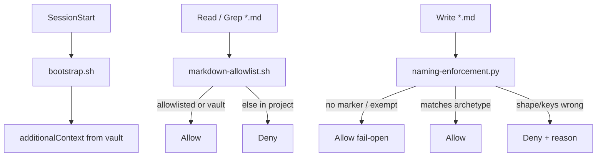

# agent-continuity (plugin package)

[](../README.md)
[](./.claude-plugin/plugin.json)

Claude Code plugin package for **Agent Continuity**. Product narrative, skill catalog, and workflow diagrams live in the [repository README](../README.md). This file is the **package reference**: hooks, layout, config keys, and dependencies.

```text
/plugin marketplace add Monolith-INC/agent-continuity
/plugin install agent-continuity@agent-continuity
```

---

## Hooks (always-on)

| Event | Script | Behavior |
| --- | --- | --- |
| `SessionStart` | `hooks/scripts/bootstrap.sh` | Inject vault bootstrap files as `additionalContext` |
| `PreToolUse` `Read\|Grep` | `hooks/scripts/markdown-allowlist.sh` | Deny project `.md` reads outside allowlist + vault |
| `PreToolUse` `Write` | `hooks/scripts/naming-enforcement.py` | Deny vault `.md` writes that violate archetype filename/frontmatter shape |



### Config resolution

1. Prefer `.claude/agent-continuity.config.json`
2. Else legacy `.claude/codex-workflow.config.json`
3. Vault folder: `vault.folder` → else `codex.folder` → else first `AI_Codex*/`
4. Bootstrap list: `vault.bootstrap` → else `codex.bootstrap` → else `README.md`, `Knowledge/Agent_Orientation.md`

### Marker resolution

1. `.agent-continuity-vault.json`
2. Legacy `.codex-vault.json`

Disable naming enforcement: `{"namingEnforcement":{"enabled":false}}`.

---

## Skills (on-demand)

| Skill | Model invoke | Needs |
| --- | --- | --- |
| `init-workspace` | no | — |
| `init-vault` | no | — |
| `init-rules` | no | — |
| `mine-style` | no | git history |
| `add-refactor-entry` | no | commit hash |
| `mine-bases` | no | existing vault |
| `query-vault` | **yes** (read-only) | Obsidian CLI + app open |
| `canvas-map` | no | Obsidian CLI + app open |
| `research-ingest` | no | Defuddle CLI |
| `vault-lint` | no | vault (+ optional `--type`) |

Full when/why/expect tables: [repository README → Skills catalog](../README.md#skills-catalog).

---

## Layout

```text
agent-continuity/
├── .claude-plugin/plugin.json
├── hooks/
│   ├── hooks.json
│   └── scripts/
│       ├── bootstrap.sh
│       ├── markdown-allowlist.sh
│       └── naming-enforcement.py
├── skills/
│   ├── init-workspace/
│   ├── init-vault/
│   ├── init-rules/
│   ├── mine-style/
│   ├── add-refactor-entry/
│   ├── mine-bases/
│   ├── query-vault/
│   ├── canvas-map/
│   ├── research-ingest/
│   └── vault-lint/
├── archetypes/          ← software-project, research, personal-pkm, technical-docs
├── scripts/vault-lint.py
├── references/frontmatter-convention.md
├── docs/obsidian-leverage.md
└── examples/agent-continuity.config.example.json
```

---

## Dependencies

| Component | Requires |
| --- | --- |
| Hooks | `bash`, `jq`, `realpath`, `python3` |
| `query-vault`, `canvas-map` | [`obsidian` CLI](https://github.com/Yakitrak/obsidian-cli), Obsidian running |
| `research-ingest` | [`defuddle`](https://github.com/kepano/defuddle) |

---

## Version history (shipped)

| Version | Milestone |
| --- | --- |
| 0.1.x | SessionStart bootstrap + markdown allowlist |
| 0.2.0 | Init skills: workspace, vault, rules |
| 0.3.0 | Mining: style + refactor catalog |
| 0.4.0 | Bases + frontmatter convention |
| 0.5.0 | `query-vault` (obsidian CLI) |
| 0.6.0 | `canvas-map` |
| 0.7.0 | `research-ingest` (Defuddle) |
| 0.8.0 | Four vault archetypes + marker |
| 0.9.0 | Write-path naming enforcement |
| 0.10.x | `vault-lint` + allowlist extensions |
| **0.11.0** | Rename to **Agent Continuity**; legacy config/marker compat |

See also [`docs/obsidian-leverage.md`](./docs/obsidian-leverage.md).
